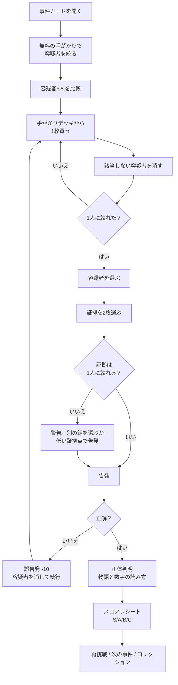
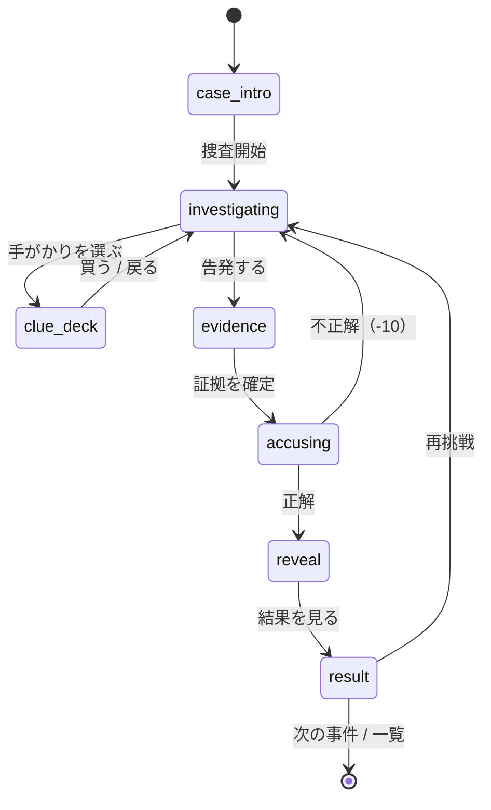

# 02. コアループとゲームルール

## 1. コアループ



**1事件 = 1つの推理。** 現在の「数字当て → ポジション当て → 描画 → 4択」のような独立した4ステップは廃止する。すべての操作が「容疑者を1人に絞る」ために使われる。

---

## 2. 1事件の画面フロー

| # | 画面 | プレイヤーがすること | ゲームがすること |
|---:|---|---|---|
| 1 | 事件カード | 事件の雰囲気、無料の手がかり、キャリア曲線を見る | 無料の手がかりを全容疑者に適用し、対象外を薄く表示 |
| 2 | 捜査画面 | 容疑者6人のカードを比較する | 各カードに判断材料（身長、所属数、通算成績、代表、タイトル、最終季）を表示 |
| 3 | 手がかりデッキ | 8枚から1枚を選び、コストを払う | 手がかりの答えを表示し、該当しない容疑者を消す（アシストON時） |
| 4 | 推理ボード | 必要なら自分で○/×/？を付ける | 消去の取り消し、メモ、残り人数を表示 |
| 5 | 告発画面 | 容疑者1人と、購入済みの手がかりから2枚を選ぶ | 2枚で1人に絞れるか、証拠の強さを判定 |
| 6 | 告発 | 確認する | 正誤判定。誤なら-10して続行、正なら開示へ |
| 7 | 正体判明 | 名前、顔、キャリア、物語を見る | 写真、スタンプ、キャッチコピー、3つの物語、数字の読み方 |
| 8 | 結果 | スコアの内訳とランクを見る | 正解/証拠/効率/減点のレシート、自己ベスト、再挑戦 |

**遷移の原則:** 事件カード → 捜査 → 告発 → 開示 → 結果は、戻るボタンで前の画面に戻れる。ただし、誤告発後は捜査に戻る。途中セーブはすべての操作後に行う。

---

## 3. 事件カード（Mystery Card）

事件カードは「謎の選手X」の匿名プロフィール。以下だけを見せる。

- ポジション（例: MF）
- 国籍（例: 日本）
- 無料の手がかり（例: 「2010年代も現役」）
- キャリア曲線（軸ラベルなし、または「デビュー / 中堅 / 引退」の3区分。具体的な年齢は出さない）
- 事件番号、タイトル、難易度、想定時間

**見せないもの:** 名前、顔、身長、利き足、所属クラブ、通算成績、代表キャップ、タイトル。これらは手がかりを買うことで判明する。

**無料の手がかりの役割:** 最初の1〜2人を消し、「自分でも解けそう」と感じさせる。全員が残る手がかりは無料にしない。残りが3人以下になる手がかりも無料にしない（簡単すぎる）。

---

## 4. 容疑者カード（Suspect Card）

6人を同じ形式で並べる。**非ファンが判断できる情報はすべて表示する。** ただし、情報密度が高すぎると読めないので、2段階にする。

### 常時表示（一覧）

- 顔写真またはシルエット
- 名前（日本語）
- ポジション / 国籍 / 生年
- 身長 / 利き足
- 現役期間
- 所属クラブ数
- 海外経験の有無
- 通算試合 / 通算得点
- 代表試合数
- J1優勝回数 / J1 MVP回数（受賞年齢）
- 最終シーズンのリーグ階層（J1 / J2 / 海外 / 下部）
- 状態ボタン（○ / × / ？）

### 詳細シート（タップで開く）

- 所属クラブの時系列（国、年、レンタル）
- 主なタイトル
- J1 MVPの受賞年（30代MVPの判定用）
- キャリア曲線の拡大
- 「この数字は何？」用語リンク
- 「消去する / 戻す」ボタン

### 表示ルール

- 数字は**比較できる順序**で並べる。例: 通算試合は多い順、代表試合は多い順。ただし、並び順で答えが推測できないように、事件ごとに固定し、ソート機能は付けない。
- 「海外経験」は国旗だけでなく「海外 ○ / ×」と文字で表示する。色だけに頼らない。
- 「最終シーズン」は `J1` / `J2` / `海外` / `下部` の4種類に単純化する。細かいリーグ名は詳細シートに置く。
- 写真がない場合は、名前の頭文字と網点のシルエットで代用する。**仮画像を本番に出さない**。

### なぜ6人か

- 4人だと、1つの手がかりで半分以上消えて簡単すぎる。
- 8人だと、スマホの一覧が長すぎて比較しづらい。
- 6人は、2×3の論理グリッドを作りやすく、1つの手がかりで2〜4人に絞る設計がしやすい。
- 上級事件では8人まで増やすが、一覧は「2人ずつ折りたたむ」などUIを変える。

---

## 5. 手がかりデッキ（Clue Deck）

### 基本

- 事件ごとに8枚（上級は10〜12枚）。
- 各カードに **コスト 1〜3pt**。
- プレイヤーの予算は **6pt**（上級は5pt、達人は4pt）。
- 購入した手がかりは消えない。買い戻しはできない。
- 購入すると、カードがめくれて「謎の選手Xの答え」と「該当する容疑者」が表示される。

### カードの構成

```
┌─────────────────────────┐
│  HAND 01        COST 1  │
│  海外キャリア            │
│                         │
│  海外のクラブで          │
│  プレーしたことは？      │
│                         │
│  [ この手がかりを買う ]  │
└─────────────────────────┘
```

購入後:

```
┌─────────────────────────┐
│  HAND 01        PAID 1  │
│  海外キャリア            │
│                         │
│  答え：ない              │
│                         │
│  該当：遠藤 / 憲剛       │
│  → 4人を消去             │
└─────────────────────────┘
```

### 手がかりの種類

1. **プロフィール系** — 身長、利き足、生年、国籍、ポジション。
2. **キャリア系** — 所属クラブ数、海外経験、最終リーグ、在籍年数。
3. **スタッツ系** — 通算試合、通算得点、代表キャップ、1試合あたり得点。
4. **タイトル系** — J1優勝、MVP、海外タイトル、代表大会。
5. **曲線系** — キャリアの山の位置、30代の出場数、ケガの谷。曲線を見くらべる。
6. **クラブ系** — 特定クラブの在籍、特定国でのプレー。名前を知らなくてもクラブ名で照合できる。

**禁止:** 「遠藤保仁ですか？」のように名前を直接含む手がかり。答えのニックネーム（「天才」「怪物」など）も、他の容疑者と共有されていない限り禁止。

### コスト設計の目安

- 1pt: 残り3人以上に絞る。単独では答えを特定しない。
- 2pt: 残り2人に絞る。または、他の手がかりと組み合わせると強い。
- 3pt: 単独で残り1人になる。ただし、証拠としては「1枚で決まる」扱いになり、Sランクは取りにくい。
- **1ptの当たり手がかり**を1枚入れる。プレイヤーが「安いのに強い」と気づくのが快感になる。
- **1ptの外れ手がかり**を1枚入れる。残り4人くらいにしか絞れず、買うと損をする。ただし、絶対に無意味にはしない（他の手がかりと組めば使える）。

### 購入のインタラクション

- カードをタップ → 確認シート（答えはまだ見せない）→ 「買う」。
- 買うと、スタンプ音、カードのめくれ、残りポイントの更新、容疑者の消去アニメーション。
- 予算不足なら、カードを揺らして「残り2pt。この手がかりは3ptです」と表示。
- 購入済みカードは「PAID」スタンプ。タップで答えを再確認できる。
- 「この手がかりで誰が消えるか」は、アシストONなら購入後に表示。OFFなら数字だけ（「4人消去」）を表示し、誰が消えるかは自分で考える。

---

## 6. 推理ボード（Deduction Board）

### アシストON（チュートリアル〜通常）

- 手がかりを買うと、該当しない容疑者に自動で薄い×が付く。
- ×の横に理由を1行表示: 「海外経験あり」「代表98試合」など。
- プレイヤーは×をタップして取り消せる。
- 画面上部に「残り 3人」と表示。
- 現在の手がかりの交点を自動計算し、残っている容疑者をハイライトする。

### アシストOFF（ハード〜達人）

- 自動消去なし。プレイヤーが各容疑者カードの「消去」ボタンで×を付ける。
- 画面上部は「購入済み 4/8」だけ。残り人数は表示しない。
- 証拠画面の「この2枚で残る人数」も、告発後にのみ表示する。
- 自分のメモと実際の論理がズレている可能性がある。それが上級者の楽しさ。

### 状態

- `○` = 候補として残している
- `×` = 消去した
- `？` = 判断保留
- `★` = 告発対象（1人だけ）

推理ボードは**メモ**であり、ゲームの正解判定には使わない。正解判定は常に実際のプロフィールと手がかりで行う。プレイヤーが誤って正解を×にしても、取り消せる。×にした容疑者は告発対象に選べない（誤操作防止）。告発したい場合は×を取り消す。

---

## 7. 告発と証拠

### 告発の条件

- 購入済みの手がかりが **2枚以上**。
- 告発対象が1人。
- 消去済み（×）の容疑者は選べない。
- 予算が0でも、手がかりが2枚以上あれば告発できる。

### 証拠の選び方

購入済みの手がかりから **2枚**を選ぶ。選んだ2枚は「この2枚で容疑者を1人に絞った」という証明になる。

- 無料の手がかりは証拠に使えない（事件の前提条件）。
- 購入した手がかりなら、使わなかったものがあってもよい。
- 2枚は、同じ手がかりの重複不可。
- 証拠画面で、以下をプレビューする（アシストON時）:
  - 「この2枚で残る容疑者: 1人」
  - 「この2枚は、どちらも欠かせない証拠です」/「1枚で決まります。もう1枚は補強です」
  - 残り2人以上なら「あと2人残ります」と表示。
- アシストOFF時は、残り人数を告発後にのみ表示。

### 証拠判定の用語

- **初期候補** = 無料の手がかりを適用した後の容疑者。
- **手がかりの残存集合** = 初期候補のうち、その手がかりに該当する容疑者。
- **ペア有効** = 2枚の残存集合の積集合が、正解1人だけ。
- **タイトな証拠** = ペア有効で、かつ**どちらの手がかりも単独では1人に絞れない**（それぞれ2人以上残る）。2枚が互いに補完している理想の証拠。
- **決定的な証拠** = 片方の手がかりだけで1人に絞れる。もう1枚は補強。ペア有効だがタイトではない。
- **関連する手がかり** = 初期候補を1人以上消せる手がかり。全員に該当する手がかりは関連しない。

### 証拠点

| 証拠の状態 | 点 | UIの表示 |
|---|---:|---|
| タイトな証拠（2枚とも必要） | 30 | 「2枚がっちり噛み合っています」 |
| ペア有効だが、片方で決まる | 20 | 「1枚で決まります。もう1枚は補強です」 |
| ペア無効だが、関連する手がかりが1枚以上 | 10 | 「まだ1人に絞れません。証拠としては弱い」 |
| 関連する手がかりがない | 0 | 「この2枚は証拠になっていません」 |

### 正誤判定

- 選んだ容疑者が正解なら、証拠点を確定し、開示へ。
- 不正解なら、**-10点**、誤告発回数+1。容疑者を×にし、捜査へ戻る。
- 誤告発後も、購入済みの手がかり、予算、メモは保持する。
- 誤告発で正解を消すことはない（正解は告発対象にならない限り消えない）。
- 同じ容疑者を2回告発することはできない。
- 誤告発のとき、購入済みの手がかりの中にその容疑者と矛盾するものがあれば、「この手がかりは、この容疑者と矛盾します」と1つだけ見せる。学習のヒントにする。

### 証拠が弱い場合

- ペア無効でも告発はできる。正解なら事件は解決するが、証拠点は10または0。
- 正解でも「なんとなく当てた」扱いになり、S/Aは取りにくい。B以下になる。
- 告発前に「この2枚では1人に絞れません。それでも告発しますか？」と確認する。非ファンが誤って低得点になるのを防ぐ。

---

## 8. 採点

### 計算式

```
正解点        = 正解 ? 50 : 0
証拠点        = タイト30 / 有効20 / 弱い10 / なし0
効率点        = round(20 × 残りポイント ÷ 6)
誤告発減点    = 10 × 誤告発回数
合計          = clamp(正解点 + 証拠点 + 効率点 - 減点, 0, 100)
```

- 予算は6pt固定。残りポイントは購入に使わなかった分。
- 誤告発は1回-10。3回で-30。正解すれば最低0で、マイナスにはならない。
- 時間はスコアに影響しない（読む速さで差を付けない）。タイムは記録だけする。
- ヒントを使った場合は-5（任意。最初は無料でもよい）。

### ランク

| ランク | 点数 | 称号 | 目安 |
|---|---:|---|---|
| S | 90〜100 | 名探偵 | 正解＋タイトな証拠＋手がかり3枚以内＋誤告発なし |
| A | 75〜89 | 敏腕刑事 | 正解＋有効な証拠。手がかり4枚以上でもA |
| B | 60〜74 | 刑事 | 正解だが証拠が弱い、または誤告発あり |
| C | 0〜59 | 見習い刑事 | 正解だが証拠なし、または複数の誤告発 |

### スコア例（FILE 001）

| ルート | 使用手がかり | 証拠 | 計算 | 合計 | ランク |
|---|---|---:|---|---:|---|
| 海外なし＋最終季J2 | 1+1=2pt | タイト | 50+30+13 | **93** | S |
| 海外なし＋身長178 | 1+1=2pt | タイト | 50+30+13 | **93** | S |
| クラブ4以下＋通算100点 | 1+2=3pt | タイト | 50+30+10 | **90** | S |
| J1優勝2回＋通算100点 | 2+2=4pt | タイト | 50+30+7 | **87** | A |
| 代表100試合＋海外なし | 3+1=4pt | 有効（決定+補強） | 50+20+7 | **77** | A |
| 海外なし＋J1優勝2回＋通算100点（証拠にC1+C5を選ぶ） | 1+2+2=5pt | ペア無効（関連2枚） | 50+10+3 | **63** | B |
| 海外なし＋最終季J2、誤告発1回 | 2pt | タイト | 50+30+13-10 | **83** | A |
| 海外なし＋最終季J2、誤告発2回 | 2pt | タイト | 50+30+13-20 | **73** | B |

**Sの条件を「手がかり3枚以内」にすることで、安い手がかりの組み合わせを探す動機が生まれる。** 3ptの決定的な手がかりを買うと、証拠点が20になり、Sは難しい。高い手がかりは「安全だが効率が悪い」、安い手がかりは「考える必要があるがSを狙える」。これがリプレイの中心。

**注:** 証拠2枚の購入が必須なので、効率点の実質最大は13（2pt使用時）。合計の実質最大は93。100点は「予算0」の理論値で、通常プレイでは到達しない。Sの表記は90〜100のままにし、実質最大が93であることは結果画面の内訳で示す。

### レシート表示

```
┌────────────────────────────┐
│  捜査報告書                 │
│                            │
│  正解            +50       │
│  証拠（2枚・タイト） +30   │
│  効率（残り4/6）  +13      │
│  誤告発           -0       │
│  ─────────────────────     │
│  合計             93  S    │
│                            │
│  使用手がかり: 2枚          │
│  誤告発: 0回                │
│  捜査時間: 5分42秒          │
└────────────────────────────┘
```

---

## 9. 難易度

| 難易度 | 容疑者 | 手がかり | 予算 | 無料手がかり | アシスト | 目標初回正解率 |
|---|---:|---:|---:|---|---:|---:|
| Easy（Tutorial） | 4 | 4〜5 | 6pt | 2枚 | 強制ON | 70〜80% |
| Normal | 6 | 8 | 6pt | 1枚 | デフォルトON | 50〜60% |
| Hard | 6 | 10 | 5pt | 1枚 | デフォルトOFF | 30〜40% |
| Expert | 8 | 12 | 4pt | 1枚 | OFF | 15〜25% |

### 難易度の上げ方

1. 容疑者を増やす（4 → 6 → 8）。
2. 予算を減らす（6 → 5 → 4）。
3. 手がかりのコストを上げる。
4. 似た属性を増やす（同じ身長、同じ代表キャップ帯、同じ最終季）。
5. 1ptの外れ手がかりを入れる。
6. アシストを切る。
7. 曲線系の「柔らかい手がかり」を入れる（「30代で出場が増えた」など、解釈が必要）。

### 難易度を下げる方法

- 無料の手がかりを2枚にする。
- 1つの手がかりで4人消えるようにする。
- 容疑者を4人にする。
- アシストを強制ONにし、購入後に「誰が消えたか」をアニメーションで説明する。
- チュートリアルでは、最初の手がかりをゲーム側が選ぶ。

---

## 10. リプレイとメタ

### 事件の再挑戦

- クリア後、同じ事件を再挑戦できる。
- 自己ベスト（ランク、点数、使用手がかり数、誤告発数、時間）を表示。
- 「前回は4枚。今回は2枚でSを狙おう」と提案する。
- 再挑戦時は手がかりと予算がリセットされる。コレクションと自己ベストは保持。

### 日替わり

- 毎日1件、4人・4手がかり・4ptのミニ事件（3〜4分）。
- 90日分の固定スケジュールをJSONで同梱。実行時にランダム生成しない（公平性と品質のため）。
- 初回クリアのみストリークにカウント。再挑戦は自己ベストのみ。
- 日替わりはVol.1の事件から作る。専用の新規事件を作る必要はない。

### コレクション

- 解決した選手のカードが「事件ファイル」に追加される。
- 未解決はシルエット＋事件番号。名前は見せない。
- カードには、顔、名前、ポジション、現役期間、3つの物語、自己ベスト、数字の読み方。
- 巻ごとの完成報酬: デスク小物、スタンプ、BGM、称号。ランダム報酬はなし。

### 実績

- 初めてのS
- 手がかり2枚でS
- 誤告発なしでVol.1クリア
- 全事件S
- 日替わり7日連続
- 用語ノートを全部埋める
- 全事件を3枚以内でクリア

### シェア

- クリア後にスポイラーなしの画像カードを生成。
- 事件番号、ランク、使用手がかり数、証拠の強さ、ゲームのロゴ。
- 選手名・顔は入れない（友達のネタバレ防止）。
- 「あなたは何枚で解ける？」のURL付き。

---

## 11. 非ファン支援

### チュートリアル

- 4人・4手がかり・6pt。3分。
- 最初の手がかりはゲームが選び、購入後の消去をアニメーションで説明する。
- 「手がかりは、答えを教えるのではなく、容疑者を消すために使う」と明示する。
- 最後に「2枚の証拠で1人に絞る」を体験して終わる。
- サッカー用語は出さない。出る場合は1行の説明をつける。

### 用語の見せ方

- 手がかりカードに「代表試合数 = キャップ数。日本代表として出た試合の数」と1行。
- 容疑者カードのラベルは「代表試合」に統一し、「キャップ」は括弧書き。
- 各画面から用語ノートを開ける。閉じたら元の画面に戻る。
- 用語ノートは事件で出会った順に追加される。最初から全部見せない。

### アシスト

- デフォルトON（Easy/Normal）。設定でOFF。
- ON: 手がかり購入後に該当しない容疑者を自動で×。理由を1行表示。
- ON: 証拠画面で残り人数と「タイト / 補強」を表示。
- OFF: 自分で消す。残り人数は告発後まで非表示。
- アシストのON/OFFでランクは変えない（難易度設定として扱う）。

### スタックしたとき

- 90秒操作がない → 「安い手がかりを1枚試そう。容疑者を半分に分けるものがおすすめ」。
- 誤告発2回 → 「この容疑者は、代表試合数が違います」など、購入済み手がかりに基づくヒントを1つ無料で表示。
- 予算0で告発できない状態は発生しない（最大コスト3×2枚=6ptで、必ず2枚買える）。
- 「事件を閉じる」でいつでも中断。進行は保存。

---

## 12. 状態遷移とセーブ



### セーブするもの

- 事件ID、開始日時、更新日時
- 購入済み手がかりID
- 消去状態（容疑者ID → ○/×/?）
- 告発対象、選択した証拠2枚
- 誤告発回数、誤告発した容疑者ID
- ヒント使用回数
- フェーズ（intro / investigating / evidence / reveal / result）
- 結果（正解、点数、ランク、使用手がかり、時間）

### セーブのタイミング

- 事件開始時
- 手がかり購入時
- 消去状態の変更時
- 証拠選択時
- 告発時（正誤とも）
- 画面を離れる時（`visibilitychange`）

### 再開

- タイトルに「続きから」を出す。事件一覧の該当ファイルにも「途中」バッジ。
- リロードしても同じ画面に戻る。
- バージョンアップでスキーマが変わった場合は、進行中の事件を安全にリセットし、トーストで知らせる。

### エッジケース

| 状況 | 挙動 |
|---|---|
| 途中でリロード | 最後のフェーズに復元。手がかり・メモ・誤告発を保持 |
| 戻るボタン（途中） | 確認ダイアログ。進行を保存して事件一覧へ |
| 予算不足で購入 | 購入不可。トーストで残りポイントを表示 |
| 購入済みを再購入 | 不可。カードはPAID表示 |
| ×の容疑者を告発 | 不可。×を取り消すよう促す |
| 証拠2枚未満で告発 | 不可。「手がかりを2枚以上買おう」 |
| 証拠ペアが無効 | 警告の上で告発可能。証拠点10/0 |
| 誤告発 | -10、容疑者を×、捜査へ戻る |
| 正解だが証拠が弱い | 解決。ランクB/C。再挑戦を促す |
| 通信なし | インストール済み事件は遊べる。写真はキャッシュ、未取得はシルエット |
| 低モーション設定 | ページめくり・スタンプアニメを即時表示。音は維持 |
| 画面サイズが小さい | 容疑者一覧をスクロール。下部のアクションバーは固定 |

---

## 13. テストすべきこと

### ロジック

- `matches(effect, suspect)` が全ケースで正しい。
- 初期候補が2〜5人になる（全員でも1人でもない）。
- 全ての手がかりが正解を含む。
- 全ての手がかりが1人以上を消す。
- タイトな証拠ペアが2組以上ある。
- 決定的な手がかりが1枚以上ある。
- 最適ルートが3pt以内でSになる。
- 誤告発の減点が正しく反映される。

### UI

- 375×667で、容疑者6人の一覧が読める。
- 手がかりデッキのカードが44px以上のタップ領域を持つ。
- 予算不足、購入済み、告発不可の状態が色だけに頼らず伝わる。
- 証拠プレビューの「残り1人 / 2人」が正しい。
- リロードで途中復元できる。
- 画面遷移が戻るボタンで破綻しない。

### アクセシビリティ

- スクリーンリーダーで容疑者カードの全数値が読める。
- キャリア曲線にテキスト代替（「序盤は少なめ、30代でピーク、40代まで続いた」など、具体的な年齢を出さない要約）がある。
- キーボードだけで手がかり購入→告発→結果まで進める。
- 200%ズームでレイアウトが壊れない。
- 色覚多様性でも×/○/？が区別できる。

### プレイテスト

- 非ファン5人: チュートリアル後、FILE 001を知識なしで解けるか。
- ファン5人: 6人の比較が簡単すぎないか。Sの手応えがあるか。
- インタビュー: 「どこで解けたと思ったか」「証拠2枚の意味がわかったか」「¥1,000のフルパッケージに価値を感じるか」。Vol.1単体の価格は別途聞く。
- 計測: 所要時間、購入手がかり数、誤告発数、ランク分布、離脱画面。

---

*次の具体例は [`03-case-001.md`](./03-case-001.md)。型と参照実装は [`04-data-schema.ts`](./04-data-schema.ts)。*
