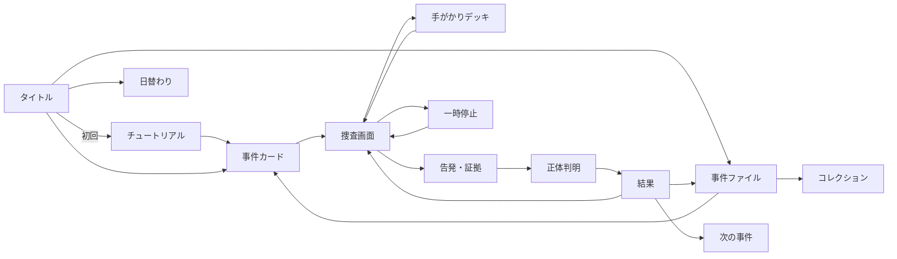

# 05. スマホ・ワイヤーフレーム

> 対象: 375×667（iPhone SE）〜430×932（iPhone Pro Max）。  
> 既存の `.stage`（max-width 460px）と紙／インクのCSS変数をそのまま使う。  
> すべての画面は「紙の事件ファイル」の上に載っている。白いカードUIにはしない。

---

## 0. 画面一覧と遷移



**原則:** 事件カード → 捜査 → 告発 → 正体判明 → 結果は一直線。結果から「次の事件へ」で、事件ファイル一覧を経由せず次に進める。現在の「事件一覧に戻って次を選ぶ」テンポの悪さをなくす。

---

## 1. タイトル / ホーム

```
┌──────────────────────────────────────┐
│ スタッツ探偵                 ♪   ≡   │
│                                      │
│  この数字、                          │
│  だれ？                              │
│                                      │
│  名前を知らなくても、数字は語る。    │
│                                      │
│  ┌────────────────────────────────┐  │
│  │ TODAY'S CASE          NORMAL   │  │
│  │ FILE 001  途切れない線         │  │
│  │ 6人 / 8手がかり / 約6分        │  │
│  │                                │  │
│  │  [ 捜査を開始する ]            │  │
│  └────────────────────────────────┘  │
│                                      │
│  [ 続きから ]     [ 事件ファイル ]   │
│                                      │
│  解決 4/10   ●●●●○○○○○○            │
│  日替わり 3日連続                    │
└──────────────────────────────────────┘
```

### 要素

- **今日の事件カード:** 未クリアの最初の事件、または日替わり。現在のタイトル画面の空白を埋める。
- **続きから:** 途中の事件がある場合だけ表示。事件名と「手がかり3枚」を小さく出す。
- **事件ファイル:** 一覧・コレクションへ。
- **進捗:** 解決数とドット。紙の台帳に鉛筆でチェックしたような表現。
- **音:** 右上に小さなスピーカー。設定は `≡` メニュー。
- **初回:** 「捜査を開始する」はチュートリアルへ。タイトルに「はじめての方へ」を出してもよいが、説明画面を読ませない。事件を始めてから教える。

### インタラクション

- カード全体がタップ領域。ボタンは下端に44px以上。
- 日替わりはカードの右上に小さなスタンプ。押すと日替わりへ。
- スクロールなしで収まる。小さい画面では「事件ファイル」ボタンが下に折り返す。

---

## 2. 事件カード（事件の導入）

```
┌──────────────────────────────────────┐
│ ←  FILE 001                NORMAL    │
│                                      │
│  途切れない線                        │
│  長く現役を続けた、静かな記録破り。  │
│                                      │
│  ┌────────────────────────────────┐  │
│  │  謎の選手 X                    │  │
│  │  MF / 日本                     │  │
│  │  2010年代も現役                │  │
│  │                                │  │
│  │      ╱╲      ╱╲                │  │
│  │    ╱   ╲____╱   ╲___           │  │
│  │  ╱                         ╲   │  │
│  │  デビュー              引退    │  │
│  └────────────────────────────────┘  │
│                                      │
│  容疑者 6人                          │
│  ┌────┐ ┌────┐ ┌────┐               │
│  │遠藤│ │俊輔│ │中田│               │
│  └────┘ └────┘ └────┘               │
│  ┌────┐ ┌────┐ ┌────┐               │
│  │小野│ │稲本│ │憲剛│               │
│  └────┘ └────┘ └────┘               │
│                                      │
│  [ 捜査を開始する ]                  │
└──────────────────────────────────────┘
```

### 要素

- **事件タイトル:** 答えを含めない。物語のフック。
- **謎の選手X:** ポジション、国籍、無料の手がかり、キャリア曲線。年齢軸は「デビュー / 中堅 / 引退」の3区分で、具体的な年齢は出さない。名前・身長・クラブは出さない。
- **容疑者6人のシルエット:** 名前は出してもよいが、写真は出さない（正体の楽しみを残す）。名前を出すことで「知っている選手かも」というファンの動機が生まれる。
- **「捜査を開始する」:** 画面下に固定。タップで捜査画面へ。
- **戻る:** タイトルへ。事件ファイル一覧へ戻る場合は左上の `←` ではなく、右上の `≡` から。

### キャリア曲線の描き方

- 6点のスパークライン。軸は「デビュー / 中堅 / 引退」の3区分。点数・順位・クラブ名・具体的な年齢は出さない。
- 線は青鉛筆。紙に手書きしたような微妙な揺れ。
- 下に「デビュー」「引退」だけ。目盛りは出さない。
- スクリーンリーダー用に「序盤は少なめ、30代でピーク、40代まで続いた」と読む。具体的な年齢は出さない。

---

## 3. 捜査画面（容疑者一覧）

```
┌──────────────────────────────────────┐
│ ←  FILE 001        残り 5人     ⏸    │
│                                      │
│  [ 容疑者 6 ]  [ 手がかり 3 ]        │
│                                      │
│  ┌────────────────────────────────┐  │
│  │ ○ 遠藤 保仁        178 / 右    │  │
│  │   MF 日本 1980  4クラブ 海外×  │  │
│  │   775試合 113点 代表152         │  │
│  │   J1優勝2 MVP1(34) 最終季J2     │  │
│  ├────────────────────────────────┤  │
│  │ ○ 中村 俊輔        178 / 左    │  │
│  │   MF 日本 1978  6クラブ 海外○  │  │
│  │   645試合 114点 代表98          │  │
│  │   J1優勝0 MVP2(22/35) 最終季J2  │  │
│  ├────────────────────────────────┤  │
│  │ × 中田 英寿        175 / 右    │  │
│  │   2010年代の現役ではない        │  │
│  ├────────────────────────────────┤  │
│  │ ○ 小野 伸二        175 / 右    │  │
│  │   ...                          │  │
│  └────────────────────────────────┘  │
│                                      │
│  ┌────────────────────────────────┐  │
│  │ [ 手がかりを選ぶ ]   3/8       │  │
│  │ [ 告発する ]                   │  │
│  └────────────────────────────────┘  │
└──────────────────────────────────────┘
```

### 要素

- **タブ:** 「容疑者」と「手がかり」。容疑者一覧と購入済み手がかりを切り替える。横スクロールのカード列は使わない。
- **残り人数:** アシストON時のみ。購入・消去のたびに更新。
- **容疑者行:** 1行目に状態＋名前＋身長/利き足、2行目に所属・海外、3行目に通算成績、4行目にタイトル・最終季。MVPは「回数（受賞年齢）」で表示する（例: `MVP1(34)`）。1行の高さは約88px。6人で528px。スクロール可。
- **状態:** `○` / `×` / `？`。左端の丸いスタンプをタップすると状態が変わる。×の行は薄くし、理由を1行表示。
- **詳細:** 行の本体をタップすると、下から詳細シート。写真、クラブ歴、タイトル、J1 MVPの受賞年、曲線、用語リンク、「消去する / 戻す」。
- **下部アクション:** 2段。上段が「手がかりを選ぶ」（primary）、下段が「告発する」（secondary）。告発は手がかり2枚未満ならdisabled。ボタンの高さは52px。
- **一時停止:** 右上。用語ノート、設定、事件を閉じる。
- **自動保存:** 状態変更のたびに保存。画面離脱時にトーストを出さない（うるさい）。

### 購入済み手がかりタブ

```
┌──────────────────────────────────────┐
│  [ 容疑者 6 ]  [ 手がかり 3 ]        │
│                                      │
│  ┌────────────────────────────────┐  │
│  │ PAID 01 海外キャリア     1pt   │  │
│  │ 答え: ない                     │  │
│  │ 該当: 遠藤 / 憲剛              │  │
│  │ 3人を消去                       │  │
│  ├────────────────────────────────┤  │
│  │ PAID 07 最終シーズン     1pt   │  │
│  │ 答え: 2部                      │  │
│  │ 該当: 遠藤 / 俊輔              │  │
│  │ 3人を消去                       │  │
│  └────────────────────────────────┘  │
│                                      │
│  [ 手がかりを選ぶ ]                  │
└──────────────────────────────────────┘
```

- 購入済みの手がかりは「PAID」スタンプ。答えと該当者を再確認できる。
- アシストOFF時は「該当者」を出さず、「3人を消去」だけ。自分で容疑者を見る。
- 手がかりをタップすると、用語ノートの該当項目へ。

---

## 4. 手がかりデッキ

```
┌──────────────────────────────────────┐
│ ←  手がかりデッキ        残り 4pt    │
│                                      │
│  8枚から選ぶ。全部は買えない。       │
│                                      │
│  ┌────────────────────────────────┐  │
│  │ 01  海外キャリア        1pt    │  │
│  │ 海外のクラブでプレーしたことは？│  │
│  │ 海外経験の有無がわかる          │  │
│  │ [ この手がかりを買う ]         │  │
│  ├────────────────────────────────┤  │
│  │ 02  所属クラブ数        1pt    │  │
│  │ プロ生活で所属したクラブは？    │  │
│  │ キャリアの選び方がわかる        │  │
│  │ [ この手がかりを買う ]         │  │
│  ├────────────────────────────────┤  │
│  │ 03  リーグ通算得点      2pt    │  │
│  │ リーグ戦の通算得点は？          │  │
│  │ 得点力の目安がわかる            │  │
│  │ [ この手がかりを買う ]         │  │
│  └────────────────────────────────┘  │
│  ... 5枚続く                         │
│                                      │
│  購入済み: 海外キャリア / 最終季     │
│  [ 捜査に戻る ]                      │
└──────────────────────────────────────┘
```

### 要素

- **残りポイント:** 画面上部に固定。購入で減る。0になっても告発は可能（手がかり2枚以上）。
- **カード:** 質問、コスト、1行の「何がわかるか」。答えは買うまで出さない。
- **購入ボタン:** カード全体ではなく、明示的なボタン。誤タップを防ぐ。
- **購入済み:** カードの上に「PAID」スタンプ。再購入は不可。
- **予算不足:** ボタンをdisabledにし、カードを少し傾ける。トーストで「残り2pt。この手がかりは3ptです」。
- **戻る:** 捜査画面へ。購入済みは保持。

### 購入確認シート

```
┌────────────────────────────────┐
│  海外キャリア          1pt     │
│                                │
│  海外のクラブでプレーしたことは？│
│                                │
│  購入すると、答えと該当する    │
│  容疑者が表示されます。        │
│                                │
│  [ 買う ]      [ やめる ]      │
└────────────────────────────────┘
```

### 購入後の結果シート

```
┌────────────────────────────────┐
│  PAID  海外キャリア      1pt   │
│                                │
│  答え: ない                    │
│  該当: 遠藤 / 憲剛             │
│  → 3人を消去                   │
│                                │
│  「海外のクラブでプレーした     │
│   ことがない選手だけが残る」   │
│                                │
│  [ 捜査に戻る ]                │
└────────────────────────────────┘
```

- スタンプ音、紙のめくれ、容疑者行の×アニメーション（300ms）。
- アシストOFF時は「3人を消去」だけ。誰が消えたかは自分で見る。

---

## 5. 告発・証拠画面

```
┌──────────────────────────────────────┐
│ ←  告発                  残り 2人    │
│                                      │
│  1. 容疑者を選ぶ                     │
│  ┌────────────────────────────────┐  │
│  │ ● 遠藤 保仁      178 / 右      │  │
│  │ ○ 中村 憲剛      175 / 右      │  │
│  └────────────────────────────────┘  │
│                                      │
│  2. 証拠を2枚選ぶ                    │
│  ┌──────────────┐ ┌──────────────┐  │
│  │ ✓ 海外なし   │ │ ✓ 最終季J2   │  │
│  │   1pt        │ │   1pt        │  │
│  └──────────────┘ └──────────────┘  │
│  ┌──────────────┐                    │
│  │   代表100+   │                    │
│  │   3pt        │                    │
│  └──────────────┘                    │
│                                      │
│  ┌────────────────────────────────┐  │
│  │ この2枚で残る: 1人（遠藤）     │  │
│  │ 2枚がっちり噛み合っています。  │  │
│  └────────────────────────────────┘  │
│                                      │
│  [ この証拠で告発する ]              │
└──────────────────────────────────────┘
```

### 要素

- **容疑者選択:** 消去済み（×）は選べない。ラジオボタン形式。詳細を見るリンク。
- **証拠選択:** 購入済みの手がかりだけ。2枚まで。選択順に1/2の番号を付ける。選択済みは青鉛筆のチェック。
- **プレビュー:** アシストON時は残り人数と、タイト/補強の説明。OFF時は「告発後に判定」とだけ表示。
- **告発ボタン:** 2枚選ぶまでdisabled。押すと確認ダイアログ。
- **戻る:** 捜査画面へ。選択は保持。

### 確認ダイアログ

```
遠藤 保仁を告発しますか？

証拠:
  海外キャリア → ない
  最終シーズン → 2部

この2枚で、遠藤保仁ただ1人に
絞れると証明します。

[ 告発する ]      [ 戻る ]
```

### 誤告発の結果

```
┌────────────────────────────────┐
│  違います。                    │
│                                │
│  中村憲剛は、最終季がJ1です。  │
│  「最終シーズン → 2部」と      │
│  矛盾します。                  │
│                                │
│  誤告発 -10点                  │
│                                │
│  [ 捜査に戻る ]                │
└────────────────────────────────┘
```

- 誤告発した容疑者は×になり、捜査画面に戻る。
- 正解を選んでいた場合は、そのまま正体判明へ。
- 証拠が弱い場合は、告発前に「この2枚では1人に絞れません」と警告。それでも告発できる。

---

## 6. 正体判明（リビール）

```
┌──────────────────────────────────────┐
│  FILE 001  解決                      │
│                                      │
│  ┌────────────────────────────────┐  │
│  │                                │  │
│  │       [ 網点の顔写真 ]         │  │
│  │                                │  │
│  │  遠藤 保仁                     │  │
│  │  MF / 日本 / 1980              │  │
│  │  1998–2023 / 26シーズン        │  │
│  └────────────────────────────────┘  │
│                                      │
│  「18歳でデビュー、43歳で引退。    │
│    線は、静かに長く続いた。」      │
│                                      │
│  01  1998  18歳でプロへ            │
│      横浜フリューゲルスでデビュー  │
│                                      │
│  02  2013  J2でも33試合            │
│      33歳で残留。翌年J1 MVP        │
│                                      │
│  03  2023  43歳で引退              │
│      代表152試合は歴代最多          │
│                                      │
│  ┌────────────────────────────────┐  │
│  │ 数字の読み方                   │  │
│  │ 通算775試合 = 26年 × 約30試合  │  │
│  │ 1試合あたり0.15点 → 組み立て役 │  │
│  └────────────────────────────────┘  │
│                                      │
│  [ 他の容疑者を見る ]  [ 結果へ ]   │
└──────────────────────────────────────┘
```

### 要素

- **写真:** 網点処理。スタンプのように「ドン」と出る。写真がない場合はシルエット＋「PHOTO PENDING」を出さない（本番では必ず用意）。
- **名前:** 大きな明朝体。朱色のスタンプ。「遠藤 保仁」。
- **キャッチコピー:** 物語の一文。
- **3ビート:** 年号、見出し、1〜2行。現在の `Story` 画面の資産を再利用。
- **数字の読み方:** この事件の学び。1つの式か図で見せる。
- **他の容疑者:** 折りたたみ。憲剛が最も近いことを明示。
- **結果へ:** 画面下に固定。

### 写真の扱い

- 既存の `public/players/endo.jpg` を再利用。
- 網点はCSSの `filter` だけでなく、事前にハーフトーン処理した画像を用意する（低スペック端末での負荷を減らす）。
- クレジットは画面下部の小さなリンクから。

---

## 7. 結果（スコアレシート）

```
┌──────────────────────────────────────┐
│  捜査報告書                          │
│                                      │
│         ┌──────────────┐             │
│         │      S       │             │
│         │    名探偵    │             │
│         └──────────────┘             │
│                                      │
│  正解                  +50           │
│  証拠（2枚・タイト）    +30           │
│  効率（残り4/6）        +13           │
│  誤告発                 -0           │
│  ───────────────────────             │
│  合計                   93           │
│                                      │
│  使用手がかり: 2枚                   │
│  誤告発: 0回                         │
│  捜査時間: 5分42秒                   │
│                                      │
│  自己ベスト: S / 93                  │
│  次は「3枚以内でS」を狙おう          │
│                                      │
│  [ もう一度 ]   [ 次の事件へ ]       │
│  [ シェア ]                          │
└──────────────────────────────────────┘
```

### 要素

- **ランクスタンプ:** S/A/B/C。紙に押したようなかすれ。 
- **内訳:** 正解、証拠、効率、誤告発。現在のレシートUIを踏襲。
- **自己ベスト:** 前回との比較。`NEW BEST` スタンプ。
- **次の目標:** ランクに応じた1行。
  - S: 「この調子。次の事件へ」
  - A: 「あと1枚減らすとS。同じ群の手がかりに注意」
  - B: 「証拠2枚で1人に絞れる組を探そう」
  - C: 「まずは安い手がかりを2枚。証拠の組み合わせを確認」
- **シェア:** スポイラーなしの画像カード。 
- **次の事件へ:** 直接次の事件へ。事件ファイル一覧を経由しない。
- **もう一度:** 同じ事件を再挑戦。自己ベストは保持。

### シェアカード

```
┌──────────────────────────┐
│ スタッツ探偵  FILE 001   │
│                          │
│      S  名探偵           │
│      93点 / 手がかり2枚  │
│                          │
│  「2枚で1人に絞れた」    │
│                          │
│  あなたは何枚で解ける？  │
│  [ QR / URL ]            │
└──────────────────────────┘
```

- 選手名・顔・答えは入れない。
- 事件タイトルとランク、使用手がかり数だけ。友達が遊べる。
- 画像は1080×1350（X/Instagram）と1200×630（OGP）の2サイズ。

---

## 8. 事件ファイル / コレクション

```
┌──────────────────────────────────────┐
│ ←  事件ファイル             Vol.1    │
│                                      │
│  解決 4/10    S 2   A 1   B 1        │
│                                      │
│  ┌────────────────────────────────┐  │
│  │ 01 途切れない線           S    │  │
│  │ 02 左足の魔法             A    │  │
│  │ 03 点取り屋の系譜         ---  │  │
│  │ 04 ???                    ---  │  │
│  └────────────────────────────────┘  │
│                                      │
│  コレクション                        │
│  ┌──────┐ ┌──────┐ ┌──────┐         │
│  │ 遠藤 │ │ 俊輔 │ │  ??? │         │
│  │  S   │ │  A   │ │      │         │
│  └──────┘ └──────┘ └──────┘         │
│                                      │
│  [ 日替わり事件 ]                    │
│  [ 実績 ]                            │
└──────────────────────────────────────┘
```

### 要素

- **巻タブ:** Vol.1〜5。未解放の巻はロック。
- **事件一覧:** ファイル番号、タイトル、ベストランク。未解決は `???` または番号だけ。答えの名前は出さない。
- **コレクション:** 解決した選手のカード。未解決はシルエット。タップで物語と数字の読み方。
- **日替わり:** 今日の事件、連続日数。
- **実績:** 全S、手がかり2枚S、用語コンプなど。
- **巻完成報酬:** デスク小物、スタンプ、BGM。ランダムなし。

### コレクションカード

```
┌────────────────────────┐
│  [ 網点写真 ]          │
│  遠藤 保仁             │
│  MF / 日本 / 1980–2023 │
│  ベスト: S / 93        │
│  事件: FILE 001        │
│                        │
│  「26シーズン、        │
│   途切れなかった線」   │
└────────────────────────┘
```

- 未解決は名前を伏せ、シルエットと「FILE 00?」だけ。
- クレジット画面はコレクションの奥に置く。全選手を最初から見せない。

---

## 9. 一時停止 / 設定

```
┌──────────────────────────────┐
│  一時停止                     │
│                              │
│  [ 捜査に戻る ]               │
│  [ 用語ノート ]               │
│  [ 設定 ]                     │
│  [ 事件を閉じる ]             │
└──────────────────────────────┘
```

### 設定

- サウンド ON/OFF
- BGM ON/OFF
- 音量（0〜100）
- 低モーション
- 文字サイズ（100% / 125% / 150%）
- 色覚多様性モード
- 消去アシスト ON/OFF
- データをリセット（確認2回）
- クレジット / データ出典 / プライバシー

### 事件を閉じる

- 「ここまでの捜査は保存されます」と確認。
- 閉じると事件ファイルへ。次に開くと「続きから」で復元。
- 誤操作防止のため、破棄ではなく保存。

---

## 10. コンポーネント一覧

| コンポーネント | 役割 | 既存資産 |
|---|---|---|
| `Stage` | 紙のステージ、max-width 460px | `styles.css` の `.stage` |
| `TopBar` | 戻る、ファイル番号、タイトル、残り人数 | `components/ui.tsx` |
| `CaseCover` | 事件カード、無料手がかり、曲線 | 新規 |
| `MysteryCard` | 匿名プロフィール | 新規 |
| `CareerSparkline` | 6点の曲線。詳細では全体表示 | `CareerChart` を簡略化 |
| `SuspectRow` | 容疑者一覧の1行 | 新規 |
| `SuspectSheet` | 詳細、クラブ歴、消去 | 新規 |
| `MarkStamp` | ○ / × / ？ | `ui.tsx` のスタンプ |
| `BudgetMeter` | 残りポイント | `ScorePill` を置換 |
| `ClueCard` | 手がかり1枚 | 新規 |
| `ClueDeckSheet` | 8枚の一覧 | 新規 |
| `PurchaseSheet` | 購入確認と結果 | 新規 |
| `EvidencePicker` | 容疑者1人＋証拠2枚 | 新規 |
| `EvidencePreview` | 残り人数、タイト/補強 | 新規 |
| `AccuseDialog` | 最終確認 | 新規 |
| `RankStamp` | S/A/B/C | 既存のゴム印 |
| `ScoreReceipt` | 内訳 | 既存 `Reveal` のレシート |
| `RevealSheet` | 写真、名前、物語 | 既存 `Reveal` / `Story` |
| `LessonCard` | 数字の読み方 | 既存の用語ノート |
| `ShareCard` | スポイラーなし画像 | 既存 `share.ts` を拡張 |
| `CaseLedger` | 事件一覧 | 既存 `Board` |
| `CollectionGrid` | 選手カード | 新規 |
| `DailyCard` | 日替わり | 新規 |
| `SettingsSheet` | 設定 | 新規 |

---

## 11. モバイルUIのルール

1. **縦一列。** 容疑者は2列グリッドにしない。375pxでは文字が小さくなる。1行88pxのリストにする。
2. **横スクロール禁止。** 手がかりデッキも容疑者も縦リスト。横カルーセルは使わない。
3. **下部固定。** primary actionは画面下。セーフエリアを考慮。
4. **タップ領域44px以上。** 状態スタンプは見た目より当たり判定を大きくする。
5. **色だけに頼らない。** ○/×/？、文字、形を併用。
6. **ホバー禁止。** すべてタップで詳細が出る。
7. **スクロールは1か所。** 画面全体は固定し、リスト部分だけスクロール。ヘッダーとアクションバーは固定。
8. **戻るは文脈で。** 捜査中は「事件ファイルへ」ではなく「一時停止」。誤タップで事件を失わない。
9. **アニメーションは短く。** ページめくり280ms、スタンプ220ms。低モーションで即時。
10. **効果音は操作の意味と一致。** 購入はタイプライター、告発は判子、誤告発は低いブザー。BGMは控えめ。

---

## 12. アクセシビリティ

- 容疑者行は `<button>`。`aria-label` に「遠藤保仁、MF、178cm、右足、4クラブ、海外経験なし、775試合、113得点、代表152試合、J1優勝2回、MVP1回、最終季J2」を含める。
- 状態スタンプは `aria-pressed` と `aria-label`（「遠藤保仁を消去済みにする」）。
- 手がかりカードは `<button>`。購入済みは `aria-disabled="true"`。
- 証拠選択は `role="checkbox"` または `aria-pressed`。選択順を `aria-label` に含める。
- 曲線は `role="img"` と `aria-label`。詳細にテキスト表を用意。
- 画面遷移後はフォーカスを先頭の見出しへ。モーダルはフォーカストラップ。
- `prefers-reduced-motion` を尊重。ページめくり、スタンプ、消去アニメを即時。
- 文字サイズ150%でも、容疑者行が2行に折り返して読める。 
- 色覚モードでは、朱色と青のコントラストを上げ、×/○に形の違いを付ける。
- スクリーンリーダーで「残り5人」などの動的更新を `aria-live="polite"` で通知。ただし連打時はまとめる。

---

*このワイヤーフレームは [`03-case-001.md`](./03-case-001.md) の事件を例にしている。実装時は [`04-data-schema.ts`](./04-data-schema.ts) の型に合わせる。*
