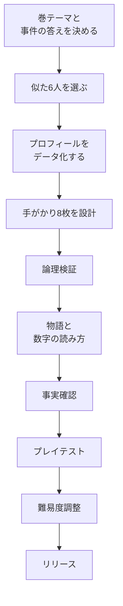

# 06. コンテンツ制作パイプライン

> 50事件を「職人芸」で作らず、**検証可能なデータ**として量産するための工程。  
> クオリティの下限を自動検証で守り、上限は編集者の物語力で作る。

---

## 1. 制作単位

### 1事件 = 1つのJSON

```json
{
  "caseFile": {
    "id": "case-001",
    "answerId": "endo",
    "suspectIds": ["endo", "nakamura", "nakata", "ono", "inamoto", "kengo"],
    "freeClues": [{ "text": "2010年代も現役", "effect": { "kind": "careerSpanIncludes", "from": 2010, "to": 2019 } }],
    "clues": [{ "id": "c1", "title": "海外キャリア", "cost": 1, "effect": { "kind": "noOverseas" } }],
    "reveal": { "catchcopy": "...", "story": [], "lesson": {} },
    "validation": { "optimalTokens": 2 }
  },
  "suspects": []
}
```

- 事件ファイルは `src/data/cases/case-001.json`。
- 選手プロフィールは `src/data/players/{id}.json` に分離してもよい。事件ファイルは `suspectIds` で参照する。
- 写真は `public/players/{id}.jpg`。ライセンス情報は `src/data/credits.json`。
- 用語は `src/lib/glossary.ts`。事件の `lesson.termIds` と一致させる。

### 1巻 = 10事件

- 巻テーマ、難易度曲線、収録選手、新要素を決める。
- 巻の最初の1事件は、新しい手がかりタイプを1つだけ導入する。
- 巻の最後の1事件は、その巻の総まとめ。似た6人＋5pt予算＋アシストOFFなど。

---

## 2. 制作フロー



### Step 1: 巻テーマと答えを決める

- 巻のテーマに合う「答え」を10人選ぶ。
- 答えは「数字に物語がある選手」であること。単に有名なだけでは弱い。
- 似た6人を作れるか（同世代、同国籍、同ポジション、同リーグ）を先に確認する。
- 6人のうち、最低1人は「最も近いライバル」になる。答えと2つ以上の属性を共有する。

### Step 2: 似た6人を選ぶ

- 6人全員が同じポジション・国籍・時代に収まるのが理想。
- 難しければ「同じポジション＋同じ時代」まで広げる。国籍は混ぜてもよいが、無料の手がかりで絞れるようにする。
- 6人のうち、**答えと最も近い容疑者**を1人決める。その1人が事件の面白さを決める。
- 6人全員に、少なくとも1つは「答えと共通する属性」を持たせる。完全な的外れを混ぜない。

### Step 3: プロフィールをデータ化する

必要なフィールド（[`04-data-schema.ts`](./04-data-schema.ts) の `SuspectProfile`）:

- 基本: 名前、写真、ポジション、国籍、生年、身長、利き足
- キャリア: 現役期間、所属クラブ、クラブ数、海外経験、最終リーグ階層
- 成績: 通算試合、通算得点、代表キャップ、J1優勝、J1 MVP、MVP年齢
- 物語: タイトル、タグ、出典
- 曲線: シーズンごとの出場・得点（任意。事件カードに使う）

**データの二重管理をしない。** 通算試合はシーズンデータから計算する。クラブ数はクラブ配列から計算する。手入力するのは、シーズンデータにない代表キャップ・タイトル・MVPだけ。

### Step 4: 手がかり8枚を設計する

- 答えが持つ属性から、8枚を選ぶ。
- すべての手がかりは、答えに対して true。
- 各手がかりは、他の誰かを1人以上消す。
- 手がかりの残存集合を表に書く。
- A群（答え＋ライバル1）とB群（答え＋ライバル2）を作り、A×Bの交点が答えになるようにする。
- 1ptの当たり手がかりを1枚、1ptの外れ手がかりを1枚入れる。
- 3ptの決定的な手がかりを1枚入れる（安全ルート）。
- 証拠に使えるタイトなペアを2組以上作る。

**手がかり設計のテンプレート:**

| 群 | 残存集合 | 手がかり例 | コスト |
|---|---|---|---:|
| A | 答え＋ライバルA | 海外未経験 / クラブ4以下 / J1優勝2+ | 1〜2 |
| B | 答え＋ライバルB | 通算100得点 / 最終季J2 / 身長178 | 1〜2 |
| C | 答えのみ | 代表100+ / 特定クラブ / 特定国 | 3 |
| D | 答え＋2人 | 30代MVP / 500試合以上 | 2（弱い） |

### Step 5: 論理検証

自動検証（後述）に加えて、手作業で以下を確認する。

- 無料の手がかりで残る人数は4〜5人か。
- 最安Sルートは3pt以内か。
- 同じ群の手がかりを2枚買うと2人残るか（学びのポイント）。
- 3ptの決定的な手がかりは、証拠20点でA止まりになるか。
- 6pt全部使うと、証拠ペア次第でB/Aになるか。
- 非ファンが容疑者カードだけで解けるか。

### Step 6: 物語と数字の読み方

- 正体判明のキャッチコピーは1文。答えの名前を含めない（事件カード側）。
- 物語は3ビート。**転機 → 谷 → 復活/円熟** の形が使いやすい。
- 数字の読み方は1つだけ。欲張らない。
  - 通算記録 → 長寿の証明
  - 1試合あたり → 役割
  - キャップ数 → 選ばれ続けた
  - 得点王 → ピークの年
  - 所属クラブ数 → キャリアの選び方
  - 最終リーグ → 終わり方
- 用語ノートに追加する用語は2〜3個。事件で実際に使ったものだけ。

### Step 7: 事実確認

- データの出典を `SourceRef` に記録する。
- 通算成績はシーズン合計と一致するか。
- 代表キャップは国際試合の表と一致するか。
- タイトル・MVPはHonoursと一致するか。
- 身長・生年・利き足はInfoboxと一致するか。
- クラブ数・海外経験はクラブ配列と一致するか。
- 写真のライセンス・作者・出典を `credits.json` に記録する。
- **本文の事実**は日本語版Wikipediaだけでなく、一次情報（Jリーグ、クラブ公式）で確認する。

### Step 8: プレイテストと難易度調整

- 非ファン3人＋ファン2人でテスト。
- 計測: 所要時間、購入手がかり数、誤告発数、ランク、離脱画面。
- 難しければ、事実を変えずに**手がかりのコスト**を下げる、無料の手がかりを増やす、容疑者を4人にする。
- 簡単すぎれば、コストを上げる、似た属性を増やす、アシストを切る、1ptの外れ手がかりを入れる。
- 目標: 初回正解率50〜60%、S 30〜40%、中央値5〜7分。

---

## 3. 事実確認ルール

### 数字の定義を固定する

| 項目 | 定義 | 注意 |
|---|---|---|
| 通算試合 | リーグ戦のみ | カップ戦、代表戦、親善試合を含めない |
| 通算得点 | リーグ戦のみ | PK含む。OGは含めない |
| 代表キャップ | A代表の国際Aマッチ | オリンピック、U-20は含めない |
| 所属クラブ数 | シニアのクラブ | 同じクラブへの復帰は1、レンタル先は別 |
| 海外経験 | 海外クラブでのプレー | レンタル含む。日本国内のみなら× |
| 最終リーグ階層 | 引退シーズンのリーグ | 海外は「海外」、5部以下は「下部」 |
| J1優勝 | 在籍クラブのJ1優勝 | 出場試合数は問わない |
| J1 MVP | Jリーグ年間MVP | 受賞時の年齢はシーズン開始時 |
| 身長 | クラブ公式/代表公式 | 1cm差は許容しない |
| 生年 | 西暦 | 年齢はシーズン開始時 |

### 出典の優先順位

1. Jリーグ公式データ、クラブ公式プロフィール
2. 日本サッカー協会（代表キャップ）
3. 英語版WikipediaのCareer statistics（リーグ戦の一次集計）
4. 日本語版Wikipediaの本文（物語の背景）
5. 新聞・雑誌のインタビュー（物語の引用。本文に使う場合は出典明記）

### 二重チェック

- 数字は**別の人が**電卓またはスクリプトで再計算する。
- 物語の事実は、本文の1文ごとに出典を紐づける。
- 「初」「最年少」「歴代最多」などの表現は、必ず一次情報で確認する。確認できなければ使わない。
- 引退後・没後の情報は `retrievedAt` を更新する。

---

## 4. 自動検証

### 事件データ

- JSONがスキーマに適合する。
- IDが重複しない。
- 答えが容疑者に含まれる。
- 無料の手がかりが答えを消していない。
- 無料の手がかりで残る人数が2〜5人。
- すべての手がかりが答えに該当する。
- すべての手がかりが1人以上を消す。
- タイトな証拠ペアが1組以上ある。
- 決定的な手がかりが1枚以上ある。
- 最適ルートが3pt以内。
- 手がかりの質問に答えの名前が入っていない。
- 写真 `ready` ならファイルが存在する。
- 出典が1件以上ある。

### 数値

- `careerApps` = シーズンの `apps` 合計。
- `careerGoals` = シーズンの `goals` 合計。
- `clubCount` = クラブ配列のユニーク数。
- `overseas` = クラブ配列に `country !== '日本'` があるか。
- `lastTier` = 最後のシーズンのリーグ階層。
- `caps` = 代表戦表の合計。
- `j1Titles` = HonoursのJ1優勝数。
- `mvpCount` = HonoursのJ1 MVP数。
- `mvpAges` = 受賞年の年齢。

### 画像

- ファイルサイズ < 200KB（WebP/AVIF）。
- 縦横比 4:5、600×750以上。
- 顔が中央に来ている。
- クレジットがある。
- `alt` テキストがある。

### 実行

```bash
node scripts/validate-cases.mjs
node scripts/check-assets.mjs
node scripts/check-credits.mjs
```

実装時は `npm run validate:content` にまとめる。CIでPRごとに実行する。

---

## 5. 難易度調整

### 計測する指標

- 初回正解率
- 平均使用手がかり数
- 平均誤告発数
- 平均所要時間
- S/A/B/Cの分布
- 離脱した画面
- 「証拠2枚で決まった」理解度（インタビュー）

### 調整の順序

1. **手がかりのコスト**を変える（事実は変えない）。
2. **無料の手がかり**を増やす/減らす。
3. **容疑者**を4人/6人/8人に変える。
4. **アシスト**の初期値を変える。
5. **予算**を6/5/4ptに変える。
6. それでもダメなら、事件自体を差し替える。

### 目標値

| 難易度 | 初回正解率 | S率 | 平均手がかり | 中央値 |
|---|---:|---:|---:|---:|
| Easy | 70〜80% | 50〜60% | 2.5枚 | 3〜4分 |
| Normal | 50〜60% | 30〜40% | 3.5枚 | 5〜7分 |
| Hard | 30〜40% | 15〜25% | 4.5枚 | 7〜9分 |
| Expert | 15〜25% | 5〜10% | 5枚 | 8〜12分 |

### 難易度の落とし穴

- **知識依存:** ファンだけが知っているクラブ事情を手がかりにしない。容疑者カードに書ける事実だけを使う。
- **総当たり:** 6ptで全部買えないからといって、当てずっぽうにならない。2枚で1人に絞れる組を必ず用意する。
- **偽の選択肢:** 明らかに的外れな容疑者を混ぜない。全員に共通点を持たせる。
- **説明不足:** 数字の定義を書かずに「通算得点」と言わない。リーグ戦のみ、と明記する。
- **ネタバレ:** 事件タイトル、フック、手がかりの質問に答えの名前・固有のニックネームを入れない。

---

## 6. 写真パイプライン

### 調達

- Wikimedia Commonsの自由ライセンス（CC BY / CC BY-SA / Public Domain）。
- クラブ公式のプレス写真は、許諾がある場合のみ。
- 商用化時は肖像・パブリシティを再確認する（今回は保留）。
- 同一選手でも、顔の向き・時代・ユニフォームを揃える。6人のトーンがバラバラだと安く見える。

### 加工

1. 4:5にトリミング。顔の中心を上から1/3に。
2. 600×750px以上。WebP/AVIFに変換。
3. 網点処理は事前にPNG/WebPで書き出す（CSSフィルタは重い）。
4. 背景は紙になじむよう、明るさ・コントラストを調整。切り抜き感を出さない。
5. `public/players/{id}.webp` に保存。既存の `.jpg` は段階的に置換。
6. `credits.json` に作者、ライセンス、ライセンスURL、出典、加工者を記録。
7. `alt` は「遠藤保仁の顔写真」ではなく「遠藤保仁」＋装飾扱いなら `alt=""`。スクリーンリーダーで名前は本文が読む。

### プレースホルダー

- 未取得は `photoStatus: "pending"`。UIはシルエット＋名前の頭文字。
- 本番ビルドでは `pending` が1件でもあればリリースしない（CIでチェック）。
- 仮画像・AI生成の顔は使わない。実在選手の顔を推測で作らない。

---

## 7. コピーガイド

### 事件カード

- 1文目で情景、2文目で謎。名前は出さない。
- 例: 「長く現役を続けた、静かな記録破り。その線は、一度も途切れなかった。」
- 「天才」「怪物」「皇帝」など、答えに固有のニックネームは使わない。他の容疑者と共有するなら可。

### 手がかり

- 質問は短く、答えは1語で。
- 数字の定義を1行で添える。
- 「〜ですか？」は丁寧すぎるので「〜は？」で統一。
- 選択肢の文章に答えの名前を入れない。
- Stamp / PAID / COST などの英語は装飾。意味は日本語で補う。

### 正体判明

- キャッチコピーは1文。詩的すぎず、事実に基づく。
- 物語は3ビート。年号、見出し、2行以内。
- 数字の読み方は1つ。中学校卒業程度の言葉で。
- 「すごい」「天才」だけで終わらせない。**何がすごいのか**を数字で説明する。

### 用語

- 用語ノートの説明は2文以内。
- 例: 「キャップ数 = 代表チームで出場した試合数。クラブでの試合は含まない。」
- 事件で出会った順に追加。最初から全部見せない。

---

## 8. 50事件の構成案

### Vol.1 日本代表の系譜（10事件）

- 答え候補: 遠藤保仁、中村俊輔、中村憲剛、小野伸二、稲本潤一、中田英寿、大久保嘉人、中澤佑二、川口能活、三浦知良など。
- テーマ: 日本代表の時代ごとの役割。MF、FW、DF、GK。
- 新要素: 基本ループ、証拠2枚、最終季、代表キャップ。
- 難易度: Easy 2 → Normal 7 → Hard 1。

### Vol.2 海を渡った男たち（10事件）

- 答え候補: 本田圭佑、香川真司、長友佑都、吉田麻也、岡崎慎司、内田篤人、清武弘嗣、乾貴士、原口元气、武藤嘉紀など。
- テーマ: 海外リーグでの挑戦。国、クラブ、移籍の数。
- 新要素: 海外クラブ、リーグの階層、レンタル、複数国。
- 難易度: Normal 6 → Hard 4。

### Vol.3 点取り屋の系譜（10事件）

- 答え候補: 大久保嘉人、ロナウド、イブラヒモビッチ、ドログバ、スアレス、レヴァンドフスキ、ハーランド、ケイン、エトー、アンリなど。
- テーマ: 得点王、ピークの年、1試合あたり得点。
- 新要素: 得点曲線、得点王、1試合あたり得点。
- 難易度: Normal 4 → Hard 5 → Expert 1。

### Vol.4 守備の芸術（10事件）

- 答え候補: マルディーニ、ブッフォン、中澤佑二、カンナヴァーロ、ネスタ、ラモス、プジョル、ノイアー、カシージャス、ファン・ダイクなど。
- テーマ: DF/GK。出場数、失点、タイトル、長寿。
- 新要素: ポジション別の数字の読み方、GKの試合数、DFの得点の少なさ。
- 難易度: Normal 4 → Hard 4 → Expert 2。

### Vol.5 世界のレジェンド（10事件）

- 答え候補: ペレ、マラドーナ、クライフ、ベッケンバウアー、ジダン、ロナウジーニョ、メッシ、C・ロナウド、ベイル、モドリッチなど。
- テーマ: 時代と国を超えた比較。キャリアの形、移籍、代表。
- 新要素: 8人、4pt、アシストOFF、曲線系の手がかり。
- 難易度: Hard 5 → Expert 5。

**注意:** 各巻の答え候補は仮。写真・データの調達可能性、ライセンス、重複を確認して確定する。50事件すべてに異なる答えを割り当てる必要はないが、コレクションの重複は避ける。

---

## 9. 制作スケジュールと体制

### 体制（最小）

- ゲームデザイナー / ディレクター 1人
- フロントエンド 1人
- デザイナー 1人（紙・写真・モーション）
- コンテンツエディター 1人（事件設計・文章）
- ファクトチェッカー 1人（兼務可）
- サウンド 1人（外注可）
- QA 1人（兼務可）

### スケジュール（Vol.1）

| 週 | 作業 |
|---:|---|
| 1–2 | 3事件の垂直スライス。ループとUIの検証 |
| 3–4 | プレイテスト、ルール調整、データスキーマ確定 |
| 5–8 | Vol.1の10事件を制作。2事件/週 |
| 9 | 事実確認、写真、用語、コレクション |
| 10 | バランス調整、アクセシビリティ、PWA |
| 11 | 最終QA、ストア素材、リリース |

### 50事件の場合

- 2事件/週 × 25週 = 約6か月。1人で全部は無理。編集者とファクトチェッカーを並行稼働する。
- 最初の10事件でテンプレートを固め、後半は週3事件に上げる。
- 写真の調達がボトルネックになりやすい。Vol.1の時点でVol.3までの写真候補を確保する。

---

## 10. リスクと対策

| リスク | 影響 | 対策 |
|---|---|---|
| 写真の権利が不明 | リリース不可 | 自由ライセンスのみ。クレジット必須。商用化時に再確認 |
| 数字の誤り | 信頼喪失 | 自動検証＋二重チェック。定義を固定 |
| 似た6人が作れない | パズルが簡単 | 容疑者プールを80人規模で先に用意。巻テーマでクラスタリング |
| 事件が単調 | 飽きる | 手がかりタイプを巻ごとに追加。曲線、海外、タイトル、代表 |
| 難易度がバラバラ | 離脱 | プレイテストの指標で調整。コストを主レバーに |
| 文章が硬い | 読まれない | 1文を短く。用語は1行説明。音読して確認 |
| 写真のトーンがバラバラ | 安く見える | 同じ加工ルール。背景・明るさ・網点を統一 |
| コンテンツ制作が遅い | リリース遅延 | 10事件でテンプレート化。JSONエディタ/検証を先に作る |
| 商用化の判断が後退 | 設計やり直し | 写真・クラブ名・リーグ名を差し替え可能に。データと表示を分離 |

---

## 11. 受け入れ基準

### 事件ごと

- [ ] 自動検証がすべて通る。
- [ ] 事実確認が2人で完了している。
- [ ] 写真のライセンス・クレジットが登録されている。
- [ ] 非ファン1人＋ファン1人が通しで遊び、致命的不具合がない。
- [ ] 初回正解率が目標範囲に入っている。
- [ ] タイトな証拠ペアが2組以上ある。
- [ ] 最適ルートが3pt以内。
- [ ] 事件タイトル・フック・手がかりにネタバレがない。
- [ ] 375×667でレイアウトが破綻しない。
- [ ] スクリーンリーダーで全数値が読める。

### 巻ごと

- [ ] 10事件の難易度曲線が設計通り。
- [ ] 新しい手がかりタイプが1つずつ導入されている。
- [ ] 答えが重複していない。
- [ ] コレクションの写真が揃っている。
- [ ] 巻の最後に総まとめの事件がある。
- [ ] 通しで遊んで、テンポが落ちない。

### リリース前

- [ ] `pending` の写真が0件。
- [ ] 全事件の自動検証が通る。
- [ ] PWAのオフライン動作。
- [ ] セーブのマイグレーション。
- [ ] アクセシビリティ監査。
- [ ] プライバシーポリシー、クレジット、問い合わせ先。
- [ ] 価格と販売形態の最終決定。

---

*この工程は [`07-roadmap.md`](./07-roadmap.md) の垂直スライスから始める。*
